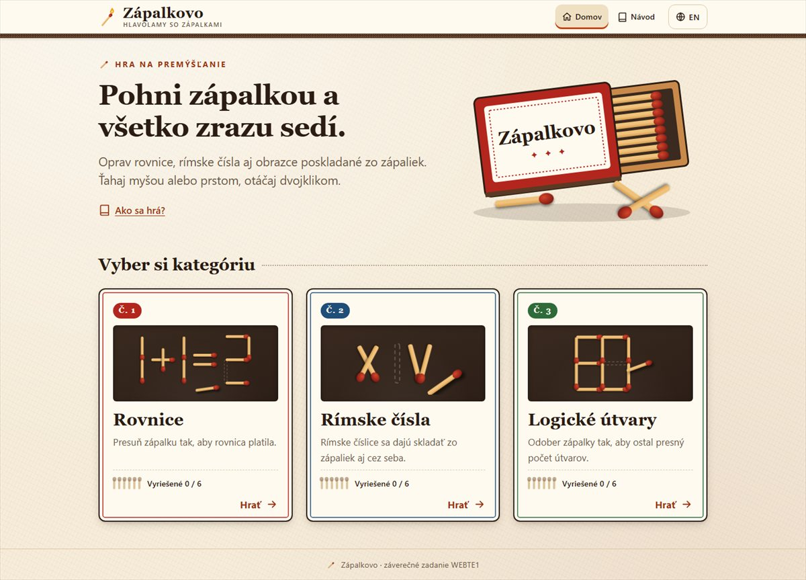
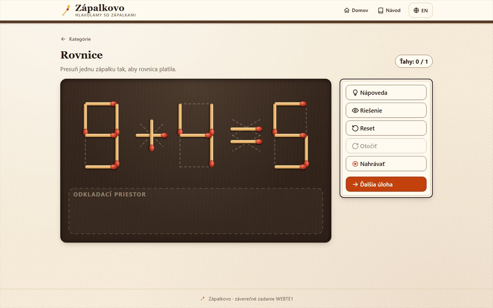

# Zápalkovo

**Zápalkovo** je webová hra (PWA) so zápalkovými hlavolamami: presuň, otoč alebo odober zápalky tak, aby rovnica platila alebo ostal presne požadovaný počet útvarov.

Záverečné zadanie z predmetu WEBTE1 (ZS 2026/27).

Autori: Meno Priezvisko, Meno Priezvisko

**Online:** https://jakubmatisak.github.io/puzzle/





## Čo hra spĺňa (body zadania)

| Bod zadania | Riešenie v Zápalkove |
|---|---|
| Responzivita, ťahanie zápaliek | Mobile-first rozloženie (telefón na výšku aj na šírku, tablet, desktop), vektorová grafika v SVG (`viewBox`), ťahanie myšou aj prstom cez Pointer Events, prichytenie k najbližšiemu voľnému miestu (snap), otáčanie o 45° (dvojklik/dvojťuk, kláves R, tlačidlo *Otočiť*), skladanie dvoch zápaliek cez seba (znamienko +, rímske X). |
| Úlohy v JSON | Všetky úlohy sú v `data/puzzles.json` (zadanie, nápoveda, riešenia; SK + EN). Úloha môže mať viac riešení. |
| ≥ 15 úloh, 3 kategórie | 19 úloh: *Rovnice* (7), *Rímske čísla* (6), *Logické útvary* (6). |
| Náhodné poradie bez opakovania | Úlohy kategórie prichádzajú náhodne; kým sa neprejdú všetky, žiadna sa nezopakuje. Poradie aj rozohraná úloha sa pamätajú v `localStorage` (prerušenie hry a návrat). |
| Koniec hry, nápoveda, riešenie, reset | Rozpoznanie vyriešenej úlohy (zoznam riešení + vyhodnotenie rovnice), počítadlo ťahov, *Nápoveda*, *Riešenie* (animované, pri viacerých riešeniach *Ďalšie riešenie*), *Reset*, *Ďalšia úloha*. |
| Senzory | Na mobile: náklon doľava = zobrazí riešenie, dvojité zatrasenie = reset. Na iPhone sa senzory povoľujú tlačidlom. |
| Video | *Nahrávať* zaznamená hraciu plochu do videa WebM (canvas + `MediaRecorder`), ktoré sa dá prehrať a stiahnuť. |
| Návod | Samostatná obrazovka *Návod* (SK/EN) so sekciou iba pre mobil; pri tlači sa vytlačí iba návod. |
| Dizajn, favicon, názov | Vlastný dizajn „škatuľka zápaliek“, svetlý aj tmavý režim, favicon v SVG, ikony PWA. |
| PWA | `manifest.webmanifest` + service worker (`sw.js`) – hra sa dá nainštalovať a funguje offline. |
| W3C | HTML aj CSS sa kontrolujú validátormi (pozri nižšie). |

## Ako sa hrá (stručne)

1. Na domovskej obrazovke vyber kategóriu.
2. Prečítaj zadanie a počet povolených ťahov.
3. Zápalku chyť a potiahni na nové miesto (alebo do odkladacieho priestoru). Dvojklikom/dvojťukom ju otočíš o 45°.
4. Keď úloha platí, zobrazí sa *Výborne!* a môžeš pokračovať *Ďalšou úlohou*.

Klávesnica: Tab vyberie zápalku, šípky ju posúvajú, Enter ju položí na miesto pod ňou (ak tam je voľné miesto, inak sa vráti späť), Escape vráti, R otočí.
Podrobný návod (aj na tlač) je priamo v aplikácii v sekcii **Návod**.

## Štruktúra projektu

```
index.html               jediná stránka: hlavička, domov, hra, návod (hash routing #/, #/help, #/play/…)
manifest.webmanifest     manifest PWA (názov, ikony, farby, scope ./)
sw.js                    service worker: uloží aplikáciu do cache, najprv sieť, potom cache
favicon.svg              favicon a zdroj ikon
icons/                   PNG ikony PWA (192, 512, maskable) – generuje npm run icons
css/
  tokens.css             farby (svetlý/tmavý režim), písma, rozostupy
  base.css               základné štýly, tlačidlá, prístupnosť
  layout.css             hlavička, domov, obrazovka hry, návod, pätička
  board.css              hracia plocha a zápalky
  print.css              tlač návodu
data/puzzles.json        kategórie a úlohy
js/app.js                vstupný bod: služby, router, prepínanie obrazoviek
js/core/                 čistá logika bez DOM (pokrytá unit testami)
  geometry.js            uhly mod 180, priťahovanie zápalky k slotu, rotácia o 45°
  glyphs.js              šablóny slotov: 7-segmentové číslice, operátory, rímske znaky
  decode.js              obsadené sloty → text rovnice
  roman.js               rímske čísla → celé čísla (s kontrolou platnosti)
  expression.js          vyhodnotenie rovnice/nerovnice (+, −, ×, =, <, >)
  lattice.js             štvorcová a trojuholníková mriežka, počítanie útvarov
  board-model.js         rozmery dosky a odkladacieho priestoru
  puzzle-state.js        stav úlohy (presun, otočenie, odloženie, plán riešenia)
  puzzles.js             načítanie a kontrola puzzles.json
  validator.js           je úloha vyriešená?
  solver.js              hľadanie všetkých riešení rovníc (iba pre dátové testy, nie je v ZIP-e ani v cache)
  queue.js               náhodné poradie úloh bez opakovania, uložený postup
  storage.js             bezpečný obal nad localStorage
  i18n.js, strings.js    preklady SK/EN
  sensors-logic.js       rozpoznanie náklonu doľava a dvojitého zatrasenia
js/ui/
  board.js               SVG doska: kreslenie, ťahanie (Pointer Events), klávesnica, animácia
  game.js                herný tok: zadanie, ťahy, nápoveda, riešenie, reset, úspech
  home.js                karty kategórií
  router.js              hash router
  sensors.js             napojenie DeviceOrientation/DeviceMotion
  canvas-renderer.js     kreslenie dosky do canvasu (video)
  recorder.js            nahrávanie videa (MediaRecorder)
  recording-ui.js        tlačidlo Nahrávať, indikátor REC, panel so stiahnutím
  install-button.js      tlačidlo Inštalovať (PWA)
  sw-register.js         registrácia service workera
docs/img/                obrázky do README
tests/unit/              unit a dátové testy (Vitest)        – iba v repozitári
tests/e2e/               end-to-end testy (Playwright)       – iba v repozitári
scripts/                 serve.mjs (lokálny server), make-icons.mjs, make-zip.mjs – iba v repozitári
```

Odovzdávaný ZIP obsahuje iba nasaditeľnú stránku, `README.md` a `PROMPTS.md`. Testy, skripty a vývojová dokumentácia (`docs/superpowers/` – návrh a plán) zostávajú v git repozitári.

## Formát `data/puzzles.json`

```json
{
  "version": 1,
  "categories": [
    {
      "id": "numbers",
      "kind": "equation",
      "name": { "sk": "Rovnice", "en": "Equations" },
      "description": { "sk": "Presuň zápalku tak, aby rovnica platila.", "en": "Move a match to make the equation true." }
    }
  ],
  "puzzles": [
    {
      "id": "num-03",
      "category": "numbers",
      "mode": "move",
      "moves": 1,
      "start": "6+4=4",
      "solutions": ["0+4=4", "8-4=4"],
      "task": { "sk": "Presuň jednu zápalku tak, aby rovnica platila.", "en": "Move one match so the equation becomes true." },
      "hint": { "sk": "Táto úloha má viac riešení. Pozri sa na prvé číslo.", "en": "This puzzle has several solutions. Look at the first number." }
    },
    {
      "id": "log-01",
      "category": "logic",
      "mode": "remove",
      "moves": 2,
      "board": { "type": "grid", "rows": 2, "cols": 2 },
      "start": "all",
      "goal": { "shape": "square", "count": 2, "noLoose": true },
      "solutions": [{ "without": ["h1-0", "v0-1"] }],
      "task": { "sk": "Odober 2 zápalky tak, aby ostali presne 2 štvorce a žiadna zápalka navyše.", "en": "…" },
      "hint": { "sk": "Skús odobrať zápalky zo stredu.", "en": "Try removing matches from the middle." }
    }
  ]
}
```

Polia úlohy:

- `id` – jedinečný identifikátor, `category` – id kategórie (`numbers`, `roman`, `logic`).
- `mode` – `move` (presúvanie) alebo `remove` (odoberanie), `moves` – počet povolených ťahov.
- `task`, `hint` – zadanie a nápoveda v slovenčine aj angličtine (nápoveda neprezrádza riešenie).
- **Rovnice** (`kind: "equation"`): `start` a `solutions` sú texty so znakmi `0-9 + - × = < > I V X` a medzerou (prázdna bunka). Štart aj všetky riešenia majú **rovnakú dĺžku** – každý znak je jedna bunka, preto sa texty zarovnávajú medzerami, napr. `"VIII+I=VII "` → `"VII +I=VIII"`.
- **Útvary** (`kind: "shapes"`): `board` je `{"type":"grid","rows":R,"cols":C}` (štvorce) alebo `{"type":"trigrid","n":N}` (trojuholníky), `start` je `"all"` (všetky zápalky) alebo zoznam slotov, `goal` je cieľ (`shape`: `square`/`triangle`, `count`, `noLoose` = žiadna zápalka navyše) a riešenie sa zapisuje ako `{"without": [...]}` – štart bez uvedených slotov. Sloty mriežky: `h{riadok}-{stĺpec}` (vodorovné), `v{riadok}-{stĺpec}` (zvislé); trojuholníková sieť: `a` (vodorovné), `l`, `r` (šikmé).

### Ako pridať úlohu

1. Do poľa `puzzles` v `data/puzzles.json` pridaj nový objekt s jedinečným `id` a existujúcou `category`.
2. Rovnicu zapíš ako zarovnané texty (`start` a všetky `solutions` rovnakej dĺžky). Útvary zapíš cez `board`, `start`, `goal` a riešenia cez `without`.
3. Doplň `task` a `hint` v oboch jazykoch.
4. Spusti `npm test`. Dátové testy overia, že úloha je platná, štart nie je vyriešený, každé riešenie sa dá dosiahnuť povoleným počtom ťahov a že zoznam riešení rovnice sa **presne zhoduje** s tým, čo nájde solver (ak solver nájde ďalšie riešenie, treba ho doplniť).
5. Ak nasadzuješ novú verziu, nič ďalšie netreba – service worker načítava najprv zo siete.

## Spustenie lokálne

Potrebný je Node.js (vývoj prebiehal na verzii 26).

```bash
npm install
npm run serve
```

Potom otvor <http://localhost:5173>. Aplikácia nemá build krok – `scripts/serve.mjs` je iba jednoduchý statický server. (Súbor `index.html` otvorený priamo z disku nefunguje, lebo ES moduly a `fetch` potrebujú HTTP.)

## Testy a kontrola kódu

```bash
npm test                  # unit a dátové testy (Vitest)
npx playwright install    # jednorazovo: prehliadače pre E2E testy
npm run test:e2e          # E2E testy (Playwright: Chromium, Firefox, emulovaný Pixel 7)
npm run lint              # html-validate (index.html) + stylelint (css/)
npm run zip               # vytvorí dist/ZZ_priezvisko.zip (názov: premenná ZZ_NAME)
```

E2E testy si samy spustia lokálny server na porte 5173. Pokrývajú ťahanie myšou aj dotykom, otáčanie, vyriešenie každej úlohy cez UI, perzistenciu poradia, senzory (simulované udalosti), nahrávanie videa, offline režim PWA a tlač návodu.

## Nasadenie na školský server

1. Vytvor ZIP: `npm run zip` (napr. `ZZ_NAME=ZZ_Novak npm run zip` v Git Bash).
2. Obsah ZIP-u (`index.html`, `manifest.webmanifest`, `sw.js`, `favicon.svg`, `icons/`, `css/`, `js/`, `data/`, …) nahraj do ľubovoľného priečinka na **HTTPS** serveri.
3. Všetky cesty sú relatívne (`./…`) a service worker má scope `./`, takže hra funguje aj v podpriečinku (napr. `https://server/~login/zapalkovo/`).
4. HTTPS je potrebné pre service worker (offline, inštalácia) aj pre senzory na mobile.

## Automatické nasadenie (GitHub Pages)

Každý push do vetvy `main` spustí workflow `.github/workflows/deploy.yml`: najprv unit testy a lint, potom `node scripts/build-site.mjs _site` (rovnaké súbory ako v ZIP-e + `.nojekyll`) a výsledok publikuje do vetvy `gh-pages`. GitHub Pages servuje vetvu `gh-pages` na adrese https://jakubmatisak.github.io/puzzle/.

## Podporované prehliadače

- Chrome / Edge a Firefox (desktop aj Android) – aktuálne verzie.
- Senzory: Android Chrome; iOS Safari po povolení tlačidlom *Povoliť senzory* (vyžaduje HTTPS).
- Nahrávanie videa vyžaduje `MediaRecorder` s WebM (Chrome, Firefox, Edge); ak chýba, tlačidlo *Nahrávať* je vypnuté s vysvetlením.

## Validácia W3C

- Automaticky: `npm run lint` (html-validate s pravidlami `html-validate:recommended`, stylelint so `stylelint-config-standard`).
- Ručne po nasadení: HTML cez <https://validator.w3.org/nu/> (adresa nasadeného `index.html`), CSS cez <https://jigsaw.w3.org/css-validator/>.
- CSS nepoužíva vlastnosti mimo štandardov W3C (žiadne `color-mix`, `backdrop-filter`, `text-wrap`). Jediné vendor rozšírenie je `-webkit-tap-highlight-color` v `css/board.css` (bez neho Chrome na mobile pri ťuknutí na zápalku bliká); Jigsaw ho hlási iba ako varovanie, nie chybu.

## Použitie AI

Riešenie bolo vytvorené s pomocou **Claude Code** (Anthropic). Postup:

1. Z textu zadania AI pripravila otázky (technológie, dizajn, ovládanie, …); odpovede sú v `PROMPTS.md`.
2. Vznikol návrh (`docs/superpowers/specs/`) a podrobný plán (`docs/superpowers/plans/`) s 19 úlohami.
3. Každú úlohu implementoval samostatný AI subagent prísne cez TDD (najprv padajúci test, potom kód), ďalší subagent ju skontroloval; nálezy sa opravili pred pokračovaním.
4. AI vygenerovala kód aplikácie, CSS, úlohy v JSON (overené solverom), testy, ikony, skripty a túto dokumentáciu.

Kód sme prešli, rozumieme mu a zaň zodpovedáme. Zoznam promptov a opis spolupráce je v [PROMPTS.md](PROMPTS.md).
